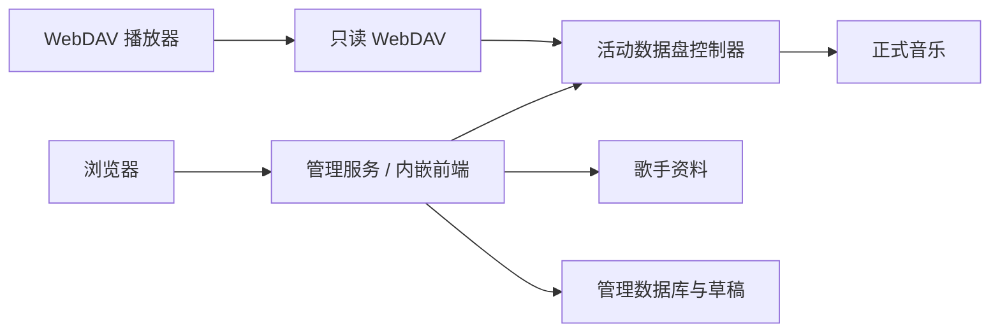

# 系统架构

系统面向一块活动 USB 音乐盘。管理 Web 编辑资源，WebDAV 通过同一个盘上下文读取正式音频。

## 职责边界

| 边界 | 职责 |
| --- | --- |
| 设备控制器 | 枚举、初始化、选盘，验证卷和挂载代次，管理盘上下文 |
| 草稿工作区 | 接收原件、读取与检测、保存编辑意图、选择歌曲、导入和删除 |
| 正式曲库 | 扫描、编辑、查询音频和公共歌手资料 |
| 操作执行器 | 串行任务、文件互斥、逐项提交、操作摘要和前向清理 |
| WebDAV | 用活动盘的正式音乐目录提供只读列表和原文件 Range 播放 |

共享资源格式由 `shared-library/` 唯一实现。WebDAV 读取正式文件，无需独立索引或后台刷新。

## 数据权威与身份

正式音频的标签、内嵌封面和公共歌手资料是资源权威。曲库索引可以重扫；管理数据库还保存不可重建的草稿和待清理路径，不能当作缓存删除。

`library-id` 是持久化盘身份；`library_session` 是一次打开曲库的内存上下文。同盘重新挂载或服务重启也会换会话，旧页面不能继续修改新上下文。选盘偏好保存在设备配置中，已选盘离线时等待其恢复，不自动使用其他盘。

盘内目录、数据库文件名及已有歌曲、草稿和设备标识保持稳定；仓库名称不决定数据目录名称。具体布局见[存储规则](docs/STORAGE.md)。

## 读取与修改

`GET /api/state` 只返回控制状态、统计、有限操作摘要和运行任务。草稿摘要与编辑详情独立查询，不暴露候选和清理所有权。

查询使用 bbolt 一致快照。不可变曲库读模型按曲目桶代次缓存分组、排序、统计和摘要，分页只复制响应页。草稿进度不使曲库索引失效；`revision` 只是查询失效提示，不是跨接口事务。

草稿保存、导入和删除携带所见内容的 `If-Match`。排队任务在受理时及取得文件锁后分别核验，拒绝把旧意图应用到新内容。运行进度和检测结果不使编辑令牌失效。

文件系统与数据库不构成跨文件事务。修改先校验原文件摘要，经临时文件改写并验证音频摘要后替换；批量任务逐首提交。失败保留已完成结果，待清理路径只向前释放。运行队列不持久化破坏性命令，也不在重启后自动重放。

## 前端状态

`AppProvider` 分别发布控制状态、稳定操作方法、曲库元数据和偏好。页面通过现有条件查询或分页资源管理取消、重试与迟到响应；编辑表单只保存本地修改。任务通知由独立服务关联任务 ID。

`DiskApp` 按盘会话重建上传、播放器和页面状态。请求在收发两端核验会话，音频与封面 URL 同样绑定会话。普通页面切换不取消上传，切盘会结束旧盘资源生命周期。

## 部署与安全

前端与 API 嵌入同一程序交付，服务更新后应刷新旧页面。运行时不需要 Node.js、Go 或数据库服务器。

局域网入口只绑定可信网段的指定 IP，管理写请求校验来源、CSRF 和曲库上下文。WebDAV 使用独立的访问密码，仅允许 `OPTIONS`、`PROPFIND`、`GET` 和 `HEAD`，从活动盘的目录句柄读取正式音频。切盘会关闭旧盘请求并使管理页面建立新会话。

启用公网域名时，ChmlFrp 将流量交给独立的回环 HTTPS 监听器。显式开启公网 WebDAV 后，播放器可通过同一域名的 `/webdav/` 连接。

Linux 启动器按可信网段识别当前地址后启动 Go 进程。管理和 WebDAV 共用进程及挂载校验，盘离线时管理页面仍可打开并选盘。
