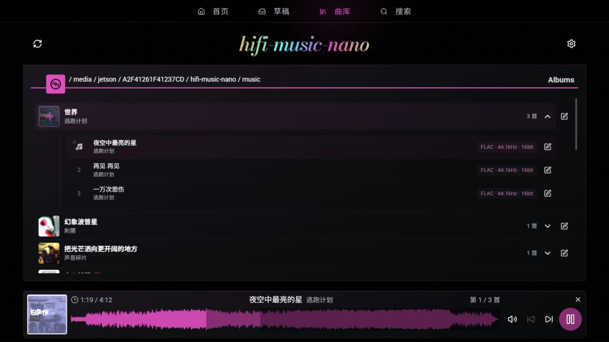
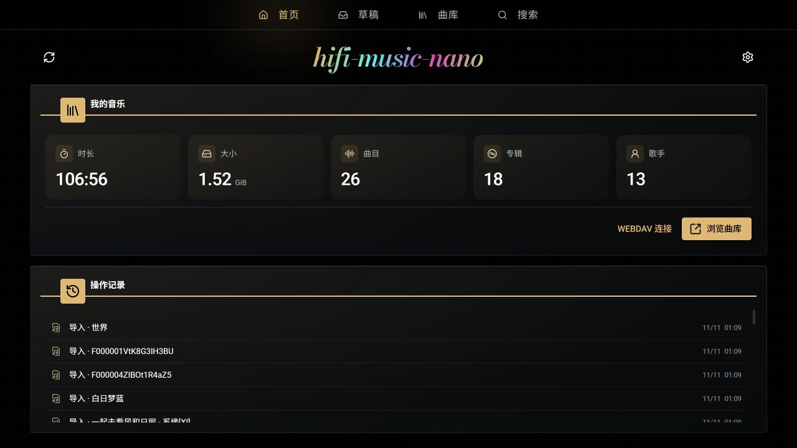
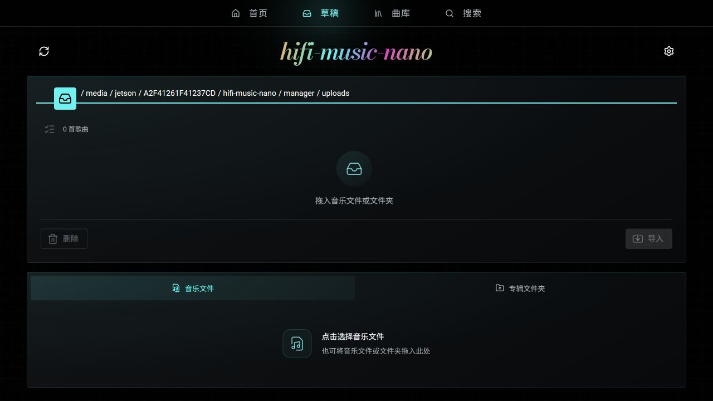

<h1 align="center">HiFi Music Manager</h1>

<p align="center">
  Your music, organized and ready to play. A self-hosted music library manager for local and LAN use.
</p>

<div align="center">

[](https://go.dev/)
[](https://react.dev/)
[](https://www.typescriptlang.org/)
[](#features)
[](#device-deployment)

</div>

<p align="center">
  English | <a href="./docs/README_zh.md">简体中文</a>
</p>

<p align="center">
  <a href="#interface-preview">Interface</a> ·
  <a href="#quick-start">Quick Start</a> ·
  <a href="#device-deployment">Deployment</a> ·
  <a href="#documentation-and-contributing">Documentation</a>
</p>

<a id="interface-preview"></a>

<table align="center">
  <tr>
    <td colspan="2" align="center">
      <a href="./docs/assets/playback.jpg"></a><br>
      <b>Listen in your browser</b>
    </td>
  </tr>
  <tr>
    <td align="center">
      <a href="./docs/assets/home.jpg"></a><br>
      <b>Home</b>
    </td>
    <td align="center">
      <a href="./docs/assets/drafts.jpg"></a><br>
      <b>Upload &amp; review</b>
    </td>
  </tr>
</table>

<p align="center">
  Captured from the running deployment on November 22, 2026, with the Chinese UI. All images are 1280 × 720 (16:9). Click an image for full size.
</p>

## About

HiFi Music Manager brings uploads, metadata, artwork, audio analysis, and playback into one music library workflow. Review albums as drafts before importing them, then browse or play the original files through read-only WebDAV.

The Go service embeds the React interface, fonts, and third-party licenses. Running a built application requires neither Node.js nor a separate database server.

## Features

- **Upload and review** — Add files or folders by selection, drag and drop, or paste. Organize drafts by album, select tracks, review duplicate-audio warnings, and import only what you choose.
- **Edit your collection** — Update tags and artwork manually. Write FLAC and MP3 metadata and covers; import other supported formats unchanged.
- **Inspect audio** — Analyze integer PCM bit depth and spectra in FLAC, WAV, and AIFF files. Results are indicators, not proof of a recording's mastering source.
- **Browse and listen** — Search albums, artists, and tracks, preview music in your browser, and manage artist portraits and biographies.
- **Use removable storage** — Select a mounted USB data disk, maintain an index for each disk, and validate its mount before accessing the library.
- **Connect your player** — Browse directories and stream original files over read-only WebDAV. Committed imports, edits, and deletions appear immediately.

Deletion is permanent, and batch operations commit one track at a time. Active drafts are not removed based on age. See [Storage and operations](./docs/STORAGE.md) for details.

## Quick Start

### Requirements

- Go 1.25+
- Node.js 22.17+
- Python 3.8+ and OpenSSH for the offline deployment tools

### Build and run on Windows

Run from the project root:

```powershell
powershell -File scripts/update-manager-local.ps1
```

Open [http://127.0.0.1:8787](http://127.0.0.1:8787). Existing users can sign in directly. To register a new user, issue an invitation for that account from the local project root:

```powershell
.\downloads\hifi-manager.exe -home .\downloads\manager-local -invite invited-account
```

Choose **注册** (Register) on the sign-in page, then enter the invitation, the account it was issued for, and a password of your choice. Invitations expire after 30 minutes and can be used once.

After signing in, select a USB data disk that is already mounted by the operating system in the home-page settings. Initialization requires explicit confirmation; it does not format the disk or remove other directories.

Choose **WebDAV 连接** (WebDAV connection) on the home page and enter the displayed address, username, and access password in a compatible player. You can also preview tracks directly in the browser.

To build without starting the service:

```powershell
powershell -File scripts/build-manager.ps1 -OutputDirectory downloads/manager-build
```

See the [Development guide](./docs/DEVELOPMENT.md) for Linux and other development environments. The service listens on loopback by default; LAN management requires an explicit trusted subnet configuration and HTTPS.

## Device Deployment

Linux ARM64 and x86_64 targets use systemd user services and a writable USB music disk mounted by the operating system.

Copy [example.json](./config/devices/example.json) to a local `config/devices/local.json` and fill in your device settings. Then run:

```console
python deployment/deploy.py --build arm64
python deployment/deploy.py --device config/devices/local.json --check
python deployment/deploy.py --device config/devices/local.json --apply
```

See the [Deployment guide](./deployment/README.md) for the full procedure. Building does not connect to a device, and updates preserve existing data, configuration, and identities.

A Nano deployment can serve the management UI and WebDAV through one ChmlFrp HTTPS tunnel. See [Public access and verification](./deployment/CHMLFRP.md).

## Project Structure

| Directory | Description |
| --- | --- |
| [`manager-service/`](./manager-service) | Go management API, React/MUI frontend, WebDAV, and audio analysis |
| [`shared-library/`](./shared-library) | Resource formats, disk identities, and safe file access |
| [`deployment/`](./deployment) | Offline builds, preflight checks, installation, and failure rollback |
| [`scripts/`](./scripts) | Local startup, build, and update tools |
| [`docs/`](./docs) | Development, API, and data rules |
| [`config/devices/`](./config/devices) | Generic device example; personal device configurations are ignored by Git |

`downloads/`, `diagnostics/`, and `secrets/` are local directories excluded from the repository.

## Documentation and Contributing

The detailed technical guides are currently in Simplified Chinese:

- [Architecture](./ARCHITECTURE.md)
- [Development and testing](./docs/DEVELOPMENT.md)
- [Management API](./docs/MANAGEMENT-API.md)
- [Storage and operations](./docs/STORAGE.md)
- [Contribution guidelines](./CONTRIBUTING.md) · [Security](./SECURITY.md)
- [Third-party sources and licenses](./NOTICE.md)

## License

The project has not yet specified a license for its own code. Third-party code, fonts, icons, and audio-analysis components retain their respective licenses; see [NOTICE.md](./NOTICE.md).
