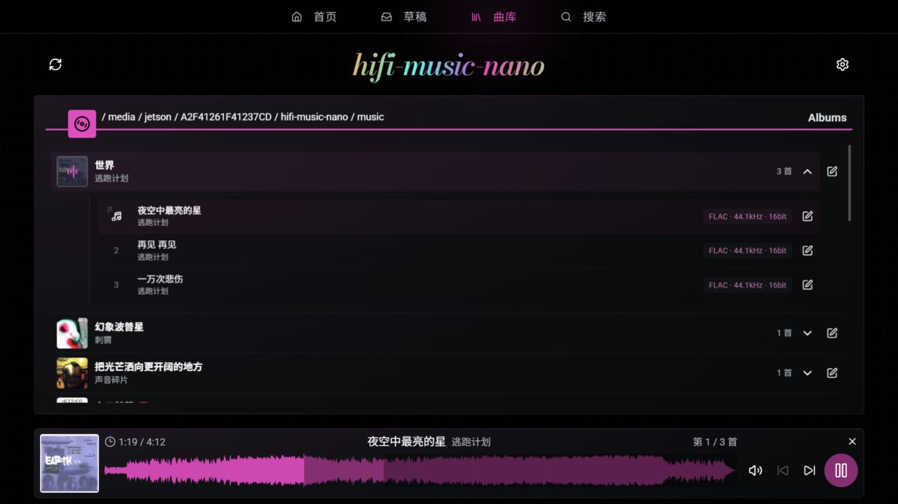
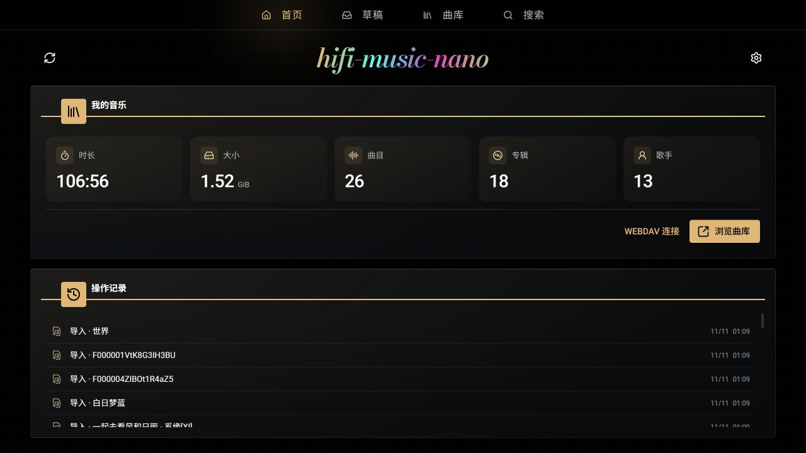
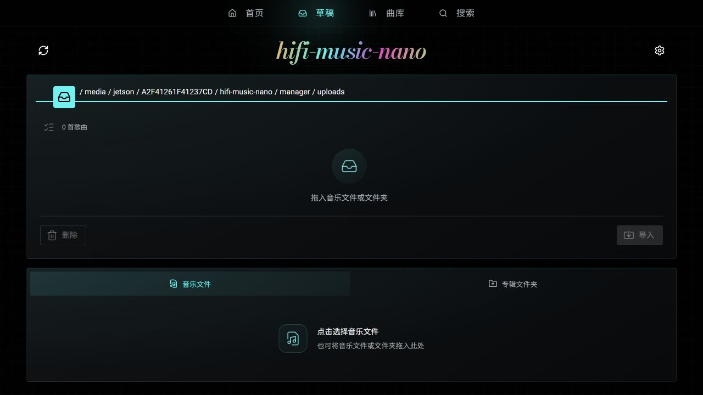

<h1 align="center">HiFi Music Manager</h1>

<p align="center">
  整理好音乐，随时开始聆听。面向本机和局域网的自托管音乐库管理工具。
</p>

<div align="center">

[](https://go.dev/)
[](https://react.dev/)
[](https://www.typescriptlang.org/)
[](#功能)
[](#设备部署)

</div>

<p align="center">
  <a href="../README.md">English</a> | 简体中文
</p>

<p align="center">
  <a href="#interface-preview">界面预览</a> ·
  <a href="#快速开始">快速开始</a> ·
  <a href="#设备部署">设备部署</a> ·
  <a href="#文档与贡献">文档</a>
</p>

<a id="interface-preview"></a>

<table align="center">
  <tr>
    <td colspan="2" align="center">
      <a href="./assets/playback.jpg"></a><br>
      <b>浏览器试听</b>
    </td>
  </tr>
  <tr>
    <td align="center">
      <a href="./assets/home.jpg"></a><br>
      <b>首页</b>
    </td>
    <td align="center">
      <a href="./assets/drafts.jpg"></a><br>
      <b>上传与检查</b>
    </td>
  </tr>
</table>

<p align="center">
  三张截图均于 2026 年 11 月 22 日从实际部署截取，界面为中文，统一为 1280 × 720（16:9）。点击图片可查看原图。
</p>

## 关于项目

HiFi Music Manager 将上传、标签与封面整理、音源检测和播放整合到同一套音乐库流程中。先按专辑检查草稿，选择歌曲导入，再通过只读 WebDAV 浏览正式曲库目录、播放原始文件。

Go 服务内嵌 React 界面、字体和第三方许可证，构建后运行无需 Node.js 或独立数据库服务器。

## 功能

- **上传与检查**：支持文件、文件夹、拖放和粘贴上传，按专辑整理草稿，多选歌曲、检查重复音频提示并选择性导入。
- **标签与封面**：手动编辑音乐信息；支持 FLAC、MP3 标签与封面写入，其他支持格式可原样导入。
- **音源检测**：分析 FLAC、WAV、AIFF 整数 PCM 位深和频谱。结果用于提示，不证明母带来源。
- **浏览与试听**：搜索专辑、歌手和曲目，在浏览器中试听，管理歌手头像与简介。
- **移动存储**：选择系统已挂载的 USB 数据盘，按盘维护索引并校验挂载状态。
- **播放器连接**：通过只读 WebDAV 浏览目录、播放原始文件；导入、编辑和删除提交后立即反映到 WebDAV。

删除为永久删除，批量操作按歌曲逐项提交。活动草稿不按年龄清理。详见[存储与操作](./STORAGE.md)。

## 快速开始

### 环境要求

- Go 1.25+
- Node.js 22.17+
- 离线部署工具另需 Python 3.8+ 和 OpenSSH

### Windows 构建与启动

在项目根目录执行：

```powershell
powershell -File scripts/update-manager-local.ps1
```

打开 [http://127.0.0.1:8787](http://127.0.0.1:8787)。已有账号可直接登录。注册新账号时，在本机项目根目录为受邀账号签发邀请码：

```powershell
.\downloads\hifi-manager.exe -home .\downloads\manager-local -invite 受邀账号
```

从登录页点击「注册」，输入邀请码、签发时指定的账号和自设密码。邀请码 30 分钟内有效，只能使用一次。

登录后可在首页设置中选择系统已挂载的 USB 数据盘。初始化需要明确确认，不格式化磁盘，也不清理盘内其他目录。

在首页点击「WebDAV 连接」，把显示的地址、用户名和访问密码填入支持 WebDAV 的播放器。浏览器仍可在曲库页面直接试听。

仅构建、不启动服务：

```powershell
powershell -File scripts/build-manager.ps1 -OutputDirectory downloads/manager-build
```

Linux 或其他开发环境的直接启动方式见[开发指南](./DEVELOPMENT.md)。默认仅监听回环地址，局域网管理需要显式配置可信网段和 HTTPS。

## 设备部署

目标支持 Linux ARM64 和 x86_64，使用 systemd 用户服务和系统挂载的可写 USB 音乐盘。

将 [example.json](../config/devices/example.json) 复制为本机的 `config/devices/local.json` 并填写设备配置，然后执行：

```console
python deployment/deploy.py --build arm64
python deployment/deploy.py --device config/devices/local.json --check
python deployment/deploy.py --device config/devices/local.json --apply
```

完整步骤见[部署指南](../deployment/README.md)。构建不会连接设备；更新保留既有数据、配置和身份。

Nano 可通过同一条 ChmlFrp HTTPS 隧道提供公网管理 Web 和 WebDAV。见[公网部署与验收](../deployment/CHMLFRP.md)。

## 项目结构

| 路径 | 职责 |
| --- | --- |
| [`manager-service/`](../manager-service) | Go 管理 API、React/MUI 前端、WebDAV 和音源分析 |
| [`shared-library/`](../shared-library) | 资源格式、盘身份和安全文件访问 |
| [`deployment/`](../deployment) | 离线构建、预检、安装与失败回退 |
| [`scripts/`](../scripts) | 本机启动、构建与更新 |
| [`docs/`](./) | 开发、接口与数据规则 |
| [`config/devices/`](../config/devices) | 通用配置示例；个人设备配置不入库 |

`downloads/`、`diagnostics/`、`secrets/` 是本机目录，不进入仓库。

## 文档与贡献

- [系统架构](../ARCHITECTURE.md)
- [开发与测试](./DEVELOPMENT.md)
- [管理 API](./MANAGEMENT-API.md)
- [存储与操作](./STORAGE.md)
- [贡献约定](../CONTRIBUTING.md) · [安全说明](../SECURITY.md)
- [第三方来源与许可](../NOTICE.md)

## 许可

项目暂未指定自有代码许可；第三方代码、字体、图标及音源分析代码保留各自许可。详见 [NOTICE.md](../NOTICE.md)。
